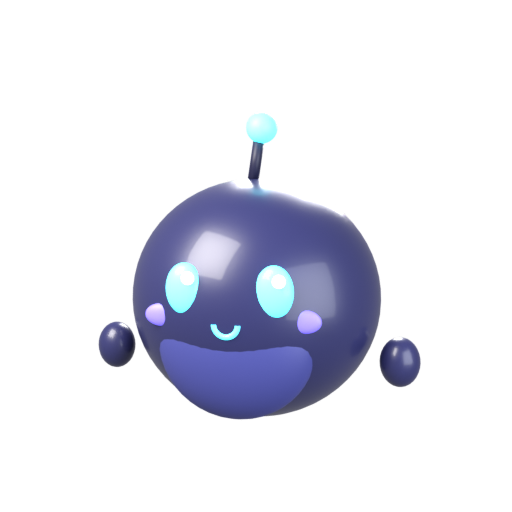

# Pip, your desktop pet


Pip is a little 3D companion that floats around your screen. Tap it, tell it what you want ("help me build a game"), and it does it right there on your computer: it looks at your screen, moves the mouse, types, opens apps and writes files.

Pip's brain is **your own Claude Code**, signed in with **your own Claude subscription** (Pro or Max). Pip never sees or stores your Claude login. It just starts the official `claude` program on your computer, the same way you would in a terminal.

## Install (one command, nothing needed beforehand)

**macOS or Linux:** open Terminal and run:

```bash
curl -fsSL https://raw.githubusercontent.com/vladypiatko-crypto/pip/main/install.sh | bash
```

**Windows:** open PowerShell and run:

```powershell
irm https://raw.githubusercontent.com/vladypiatko-crypto/pip/main/install.ps1 | iex
```

The installer:
- downloads its own private copy of Node.js and Pip, under `~/.pip-pet` or `%LOCALAPPDATA%\PipPet`;
- installs [Claude Code](https://code.claude.com/docs/en/setup) with Anthropic's official installer if you don't already have it;
- adds **Pip** to your apps (a `pip-pet` command on Mac/Linux, Start menu and desktop shortcuts on Windows);
- starts Pip.

Pip appears in the bottom-right corner of your screen. The first time, if Claude Code isn't signed in yet, Pip shows a **Sign in to Claude** button that opens the sign-in for your Pro or Max plan. To update Pip later, just run the same command again: your settings and skins are kept.

Pip runs on desktops and laptops (Windows, macOS, Linux), not on phones or tablets.

<details><summary>Install by hand instead (for developers)</summary>

Install Node.js 18+ and Claude Code, run `claude` once to sign in, then:

```bash
git clone https://github.com/vladypiatko-crypto/pip && cd pip
npm install
npm start
```
</details>

### Extra permissions per system

- **macOS:** the first time Pip uses your computer, macOS will ask for **Screen Recording** and **Accessibility**. Allow them for Pip (it shows up as "Electron" when run from source), then restart Pip.
- **Windows:** nothing extra. If clicks land in the wrong place on a high-DPI screen, tell me and I'll adjust the scaling.
- **Linux:** works on X11. Wayland sessions block apps from controlling the mouse, so log in with an "X11"/"Xorg" session.

## Using Pip

- **Tap** Pip to open the chat. **Drag** Pip to move it.
- The **first time** you ask for something, Pip asks once: *"Can Pip use your computer?"* **Allow** lets it see your screen, use the mouse and keyboard, and create files and run commands in its own `Documents/Pip Projects` folder. **Chat only** means it just talks. You can change this any time in Pip's settings (⚙) or from the tray menu.
- While Pip works, it shows what it's doing ("👀 Looking at your screen", "🖱️ Clicking", "📝 Writing a file"). Press **Stop** at any time.
- **＋** starts a new conversation. Otherwise Pip remembers what you were doing.
- **🕘 Continue a chat:** every conversation is saved. Pick one to carry on right where you left off, and Pip remembers everything from it.
- **Model and effort:** the two menus above the chat pick the model (Opus 5.5, Sonnet 5.5, Haiku 5.5 or Fable 5.1, if your plan includes it) and how hard Claude thinks (low to max). Lower effort and smaller models use less of your plan.
- **📊 Usage:** see how much of your plan's **5-hour** and **weekly** limits you've used and when they reset, plus how many answers and tokens Pip used today, this week and this month, a 14-day chart, and a breakdown by model and by shared rooms.
- **👥 Chat together:** see below.
- Pip won't type passwords or payment details, buy things, or delete your files. It stops and asks you to do those parts.

## Skins

### Pip designs its own

Just ask: *"make yourself a pirate skin"*, *"design a dragon outfit with wings"*, or tap **✨ Design one** in Settings → Skins. Pip picks the colors, switches the built-in accessories on or off, and builds new ones out of 3D shapes (hats, horns, wings, glasses, a sword in its hand...). Then it puts the outfit on and takes its own picture for the skin list. Pip-made skins have a ✕ to delete them. This works even in *Chat only* mode, since it doesn't touch your computer.


### Built-in skins

Six skins, all modeled in Blender: **Ember**, **Mint Sprout**, **Midnight**, **Royal** (crown), **Robo** (headphones) and **Frost** (beanie). Pick one in ⚙ Settings or from the tray menu.

| Ember | Mint Sprout | Midnight | Royal | Robo | Frost |
|---|---|---|---|---|---|
|  |  |  |  |  |  |

### Make one by hand

1. Add an entry to `assets/skins.json`: colors for each part, plus which accessories it wears (`stem`, `bulb`, `leaf`, `crown`, `headphones`, `beanie`).
2. Rebuild the model and previews with Blender:

```bash
blender -b -P blender/build_pet.py
```

No Blender app? `pip install bpy` gives you Blender as a Python module, then run `python blender/build_pet.py`. Add `--no-render` to skip the preview pictures.

To add a new accessory, model it in `blender/build_pet.py` and give it a `part` name (see how `crown` is done), then list that name in a skin's `parts`.

## Chat together, everyone on their own subscription

Tap Pip, then **👥**:

1. **Host:** type your name and a room name, and press **Host**. Pip starts the room on your computer, makes a free public link, opens the room in its own window, and copies the invite link for you. Send that link to your friends.
2. **Join:** your friends paste the link into *their* Pip (👥 → **Join**). The room opens for them already joined.
3. Everyone chats in one room. Press **Ask Claude**, or start a message with `@claude`, and Claude reads the whole conversation and answers. **Whoever asks pays with their own subscription**, through their own Pip and Claude Code. Each answer says "paid by *name*'s Claude subscription", and the **Usage** button in the room shows who used what.
4. Each person picks their own model and effort in the room's **Settings**. **Recent rooms** in 👥 reopens a room later, with the whole history kept.

Good to know:
- The host's computer has to stay on with Pip running. If the host closes Pip and hosts the room again later, the history is still there, but the public link is new, so share the new one.
- If the public link can't be created (some work or school networks block it), Pip gives a same-Wi-Fi link instead.
- Friends without Pip can still join from a web browser and use an Anthropic API key in the room's Settings.
- Room questions are **chat only**: Pip turns off all of Claude's tools for them, so other people's messages can never make it touch your computer.
- Want a room that's always online? Run the server in [`room/`](room/) on any always-on computer or host (`cd room && npm install && npm start`), then join it from Pip with its link.

## How it works

```
 Pip window (Electron + three.js)  ── tap / chat ──►  main.js
                                                        │ starts your own `claude -p` (lib/claude.js)
                                                        ▼
                                          Claude Code (your subscription login)
                                                        │ calls tools from the "pip" MCP server
                                                        ▼
                         mcp/computer-server.mjs ──localhost + secret token──► lib/control.js
                                                                     screenshots (Electron), mouse & keys (nut.js)
```

- `blender/build_pet.py`: models Pip and its accessories, exports `assets/pip.glb`, renders the previews.
- `renderer/`: the 3D pet (moods: idle, thinking, working, talking, happy, sad), the chat bubble and settings.
- `lib/claude.js`: runs the unmodified `claude` program and reads its streaming output. It removes `ANTHROPIC_API_KEY` from the environment so your subscription is used, not an API key.
- `lib/control.js` and `mcp/computer-server.mjs`: the computer-use tools (screenshot, click, move_mouse, drag, type_text, press_keys, scroll, wait, open). They only work while you've allowed computer access, and only for requests carrying a secret token created at startup.
- `lib/room.js`: the Claude Room link. `lib/host.js`: one-click hosting (the room server plus a Cloudflare quick tunnel for the public link).
- Model/effort come from Claude Code's `--model` and `--effort` options. Continue uses `--resume`. Usage comes from the token counts and plan limits Claude Code reports with each answer, saved in Pip's settings folder (`usage.json`, `chats.json`).
- Skin designer: the `save_skin`, `wear_skin`, `list_skins` and `delete_skin` tools in `mcp/computer-server.mjs`. `main.js` checks every value Claude sends before saving it, and the pet builds the shapes in `renderer/pet3d.js`.
- `install.sh` and `install.ps1`: the one-command installers.
- `room/`: the Claude Room shared chat server. `docs/subscriptions-research.md` has the research on using Claude subscriptions in shared apps.

To preview the pet's look in a browser without Electron, serve this folder (e.g. `python -m http.server`) and open `/renderer/index.html` (replies are fake in preview mode).

## About Anthropic's rules

As of November 2026, Anthropic allows people to sign in to the **unmodified Claude Code program with their own subscription**, including when another app starts it for them. It does **not** allow apps to offer their own "Sign in with Claude", or to collect, store or pass along Claude logins. Pip follows the allowed pattern: each person runs Pip and Claude Code on their own computer under their own login. Pip never touches the login, and it doesn't charge for or resell anything. Anthropic's rules have changed several times in 2026, so check [their current page](https://code.claude.com/docs/en/legal-and-compliance) if you plan to share Pip publicly.
